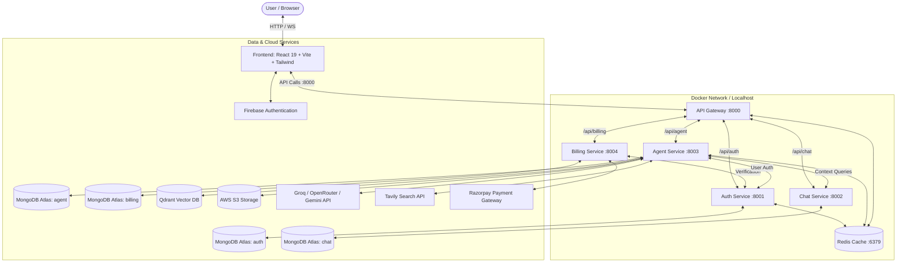

# CortexAI

An enterprise-grade, distributed AI platform built with a microservices architecture. CortexAI orchestrates multimodal AI agents, real-time contextual chat, secure authentication, subscription billing, and seamless data processing.

---

## 🏛️ System Architecture



---

## 📦 Services Breakdown

| Service | Port | Description | Tech Stack |
|---|---|---|---|
| **API Gateway** | `8000` | Reverse proxy, request routing, rate limiting, and CORS handling | Express, Express HTTP Proxy, Redis, Cookie Parser |
| **Auth Service** | `8001` | User registration, authentication, Firebase Admin SDK integration, and token management | Express, MongoDB (Mongoose), Firebase Admin, Redis |
| **Chat Service** | `8002` | Real-time chat threads, message histories, and conversational persistence | Express, MongoDB (Mongoose) |
| **Agent Service** | `8003` | Core AI engine: autonomous agents, RAG vector retrieval, document analysis, and web search | Express, LangChain / LLM APIs, Qdrant, AWS S3, Redis |
| **Billing Service** | `8004` | Subscription plans, payments, invoices, and webhook management | Express, MongoDB (Mongoose), Razorpay SDK |
| **Frontend** | `5173 / 5175` | Interactive modern dashboard, chat interfaces, and code editing | React 19, Vite, Tailwind CSS, Redux Toolkit, Monaco Editor, Lucide |
| **Redis** | `6379` | In-memory message broker, distributed caching, and session storage | Redis |

---

## 🛠️ Prerequisites

Before getting started, make sure you have the following installed:

- **Node.js** (v20+ recommended) & **npm**
- **Docker** & **Docker Compose**
- **MongoDB Atlas** account (or local MongoDB)
- **Git**

---

## ⚙️ Environment Variables

Each microservice and the frontend maintain their own `.env` configuration. Pre-configured `.env.example` templates are provided across the repository:

| Service | Example File |
|---|---|
| Gateway | `backend/gateway/.env.example` |
| Auth Service | `backend/services/auth/.env.example` |
| Chat Service | `backend/services/chat/.env.example` |
| Agent Service | `backend/services/agent/.env.example` |
| Billing Service | `backend/services/billing/.env.example` |
| Frontend | `frontend/.env.example` |

To configure each service, copy the `.env.example` to `.env`:
```bash
cp backend/gateway/.env.example backend/gateway/.env
cp backend/services/auth/.env.example backend/services/auth/.env
cp backend/services/chat/.env.example backend/services/chat/.env
cp backend/services/agent/.env.example backend/services/agent/.env
cp backend/services/billing/.env.example backend/services/billing/.env
cp frontend/.env.example frontend/.env
```
Fill in your credentials (MongoDB connection strings, API keys, etc.).

---

## 🚀 Quick Start

### 1. Run the Entire Backend via Docker Compose (Recommended)

To build and start all backend services (`redis`, `auth`, `chat`, `agent`, `billing`, and `gateway`) in one command:

```bash
cd backend
npm run dev
# or directly:
# docker compose up -d
```

To stop all backend containers:
```bash
cd backend
docker compose down
```

### 2. Run Backend Services Individually (Local Node.js Development)

If you prefer running services directly on your host machine:

1. **Start Redis:**
   ```bash
   cd backend
   docker compose up -d redis
   ```

2. **Start Auth Service:**
   ```bash
   cd backend/services/auth
   npm install
   npm run dev
   ```

3. **Start Chat Service:**
   ```bash
   cd backend/services/chat
   npm install
   npm run dev
   ```

4. **Start Agent Service:**
   ```bash
   cd backend/services/agent
   npm install
   npm run dev
   ```

5. **Start Billing Service:**
   ```bash
   cd backend/services/billing
   npm install
   npm run dev
   ```

6. **Start API Gateway:**
   ```bash
   cd backend/gateway
   npm install
   npm run dev
   ```

### 3. Run the Frontend

In a separate terminal window:

```bash
cd frontend
npm install
npm run dev
```

Open your browser at `http://localhost:5173` (or `http://localhost:5175`).

---

## 📡 API Routing via Gateway

All frontend client requests route through the API Gateway at port `8000`:

| Gateway Route | Target Microservice | Authentication Required |
|---|---|---|
| `/api/auth/*` | Auth Service (`:8001`) | No / Custom |
| `/api/chat/*` | Chat Service (`:8002`) | Yes (Protected) |
| `/api/agent/*` | Agent Service (`:8003`) | Yes (Protected) |
| `/api/billing/*` | Billing Service (`:8004`) | Yes (Protected) |
| `/api/me` | Current Authenticated User | Yes (Protected) |

---

## 🔗 Repository

GitHub Repository: [https://github.com/Avinash-9931/CortexAi.git](https://github.com/Avinash-9931/CortexAi.git)

---

## 📄 License

This project is licensed under the ISC License.
